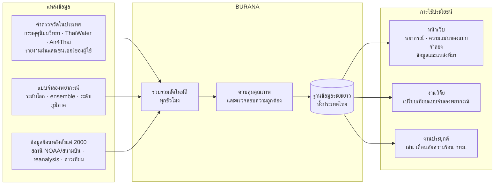
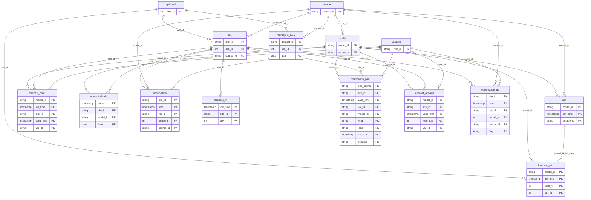

<p align="center">
  &nbsp;&nbsp;
  &nbsp;
  
</p>

# BURANA (บูรณา): ฐานข้อมูลเปิดแบบบูรณาการของข้อมูลภูมิอากาศและแบบจำลองพยากรณ์อากาศของประเทศไทย

**B**ig-data **U**nified **R**epository of **A**tmospheric observations and **N**umerical forecast **A**rchives ·
พัฒนาโดย วิทยาลัยบูรณาการศาสตร์ มหาวิทยาลัยเกษตรศาสตร์ · (repository เปลี่ยนชื่อจาก `consolidated-weather` เมื่อ 27 ต.ค. 2569 — GitHub ส่งต่อลิงก์ repository เดิมให้อัตโนมัติ)

ระบบรวบรวมข้อมูลอุตุนิยมวิทยาแบบอัตโนมัติ ประกอบด้วยสามส่วน:

1. **ข้อมูลพยากรณ์** จากแบบจำลองเชิงตัวเลขและแบบจำลองปัญญาประดิษฐ์ **12 ระบบ** ได้แก่ แบบจำลองโลก 10 ระบบ, TMD WRF 2 กม. และ Google Weather รวมถึง **ensemble 6 ระบบ** และ **HII WRF-ROMS** (สสน.) ระยะล่วงหน้า 3 ชั่วโมงถึง 7 วัน
2. **ค่าตรวจวัด** จากสถานีอุตุนิยมวิทยา ~122 แห่ง, โทรมาตร ThaiWater ~4,300 เครื่อง และรายงานฝนจากผู้ใช้
3. **การตรวจสอบความถูกต้อง** (forecast verification) ตามแนวทางขององค์การอุตุนิยมวิทยาโลก (WMO)

ผลลัพธ์ทั้งหมดจัดเก็บใน **ฐานข้อมูลระยะยาวที่มีโครงสร้าง (wxdb)** ครอบคลุมทั้งประเทศ และเผยแพร่ผ่านหน้าเว็บ ระบบใช้บริการที่ไม่มีค่าใช้จ่ายทั้งหมด

**บทบาทของ repository นี้:** เป็น**ระบบกลางสำหรับรวบรวมและจัดเก็บข้อมูลอากาศและแบบจำลองพยากรณ์**ของประเทศไทย ไม่ผูกกับโครงการใดโครงการหนึ่ง
งานประยุกต์ (application) อ่านข้อมูลจากที่นี่ผ่าน `wxdb.connect()` หรือหน้าเว็บ แล้วพัฒนาต่อใน repository ของตนเอง เช่น
**HEAT-SAFE Bangkok** (repository แยก) ซึ่งใช้ข้อมูลสถานีและพยากรณ์ไปประเมินและเตือนภัยความร้อน
ข้อมูลเฉพาะของงานประยุกต์ (เช่น ดัชนีความเปราะบาง หรือพื้นที่เป้าหมาย) ไม่จัดเก็บใน repository นี้
ยกเว้นโมดูลพยากรณ์ภัยความร้อนรายเขต (`weather_heatsafe.py`, แท็บ 🌡️ บนหน้าเว็บ) ซึ่งเป็นส่วนของ HEAT-SAFE ที่ฝากรันไว้ที่นี่ชั่วคราว

🌐 **หน้าเว็บ** (ปรับปรุงทุกชั่วโมง): https://navavit.github.io/burana/ ·
🗄️ **ฐานข้อมูล:** [docs/DATABASE.md](docs/DATABASE.md) ·
📖 **แบบจำลองและวิธีการ:** [docs/MODELS.md](docs/MODELS.md) ·
⏱️ **การตั้งเวลา:** [docs/SCHEDULER.md](docs/SCHEDULER.md)

ระบบนี้เป็นขั้นตอนหนึ่งของโครงการวิจัย **HEAT-SAFE Bangkok** (วช. 2570) โดยทำหน้าที่จัดหาข้อมูลพยากรณ์ ข้อมูลสถานี และผลทดสอบย้อนหลัง พร้อมพยากรณ์ภัยความร้อนรายเขตของกรุงเทพมหานคร ทั้งนี้ออกแบบให้ใช้ซ้ำในงานวิจัยอื่นได้

## 1. สถาปัตยกรรมและการไหลของข้อมูล



| ขั้นตอน | ความถี่ | โปรแกรม | ผลลัพธ์ |
|---|---|---|---|
| เก็บข้อมูลและตรวจสอบ | ทุกชั่วโมง | `collector.py run` (`collect.yml`) | branch `data`, หน้าเว็บ |
| พยากรณ์ภัยความร้อนรายเขต กทม. | ทุก ~3 ชั่วโมง | `weather_heatsafe.py` | `heatsafe.json`, ค่ารายวันต่อแบบจำลอง |
| พยากรณ์รายจังหวัดและความถูกต้องรายสถานีทั่วประเทศ | ทุก ~6 ชั่วโมง / ทุกชั่วโมง | `weather_national.py` | `national.json`, ค่ารายวันต่อแบบจำลอง |
| พยากรณ์กริดทั่วประเทศ (0.25°) | วันละ 2 รอบ | `python -m wxdb grid` (`database.yml`) | ตาราง `forecast_grid` |
| แปลงคลังระยะสั้นเข้าฐานข้อมูล | วันละครั้ง | `python -m wxdb etl` | ตารางค่าตรวจวัด พยากรณ์ และคู่ตรวจสอบ |
| พยากรณ์ ณ สถานีอุตุนิยมวิทยาทุกแห่ง (จุดตรวจทั่วประเทศ, อุณหภูมิและฝนของทุกแบบจำลอง) | ทุก 6 ชั่วโมง | `weather_verify.collect_national` | branch `data` → ตาราง `forecast_point` |
| ค่าตรวจวัดย้อนหลัง (NOAA GHCNh รายชั่วโมง, GSOD รายวัน) และ ERA5-Land/CHIRPS รายวัน ตั้งแต่ 2000 | รายเดือน | `python -m wxdb history`, `reanalysis` | ตาราง `observation`, `reanalysis_daily` |
| ควบคุมคุณภาพฝนรายวันของโทรมาตร (เทียบสถานีข้างเคียง) | วันละ 2 รอบ | `python -m wxdb qc` | ตาราง `observation_qc` |
| พยากรณ์ย้อนหลัง ณ สถานีกรมอุตุฯ (Open-Meteo Previous Runs, ก.ค. 2024 – ก.ย. 2026) | วันละ 2 รอบ จนครบ (≤ 2,000 หน่วยโควตา/รอบ) | `python -m wxdb prevruns` | ตาราง `forecast_prevrun` |
| ฝนจากดาวเทียม IMERG / GSMaP รายวัน (2000–) | ดึงในเครื่องผู้ดูแล (GEE) | `python -m wxdb reanalysis --source gee --datasets imerg gsmap` | ตาราง `reanalysis_daily` |
| รวมไฟล์รายเดือนและลดขนาดคลังระยะสั้น | รายเดือน | `python -m wxdb pack`, `prune` | `<table>__YYYY-MM.parquet` |
| ซ่อม manifest (ไฟล์ที่หลุดจากการบันทึกพร้อมกัน) | วันละครั้ง | `python -m wxdb reconcile` | `manifest.json` |
| เซนเซอร์ของผู้ใช้ (ThingsBoard; ต้องตั้ง secret `PFAL_PUBLIC_ID`) | วันละ 2 รอบ | `python -m wxdb sensor` | ตาราง `observation` |
| ทดสอบพยากรณ์ภัยความร้อนย้อนหลังที่สถานีใน กทม. → ค่าปรับแก้ของโมดูลภัยความร้อน | เมื่อมีข้อมูลฤดูร้อนใหม่ (สั่งรันเอง) | `analysis/heat_forecast_backtest.ipynb` | `resources/heatsafe_calibration.json`, `analysis/heat_backtest/` |

## 2. โครงสร้างฐานข้อมูล (ER diagram)

แบบจำลองดาว (star schema): ตารางมิติอธิบายแหล่งข้อมูล แบบจำลอง ตัวแปร จุด และเซลล์กริด ส่วนตารางข้อเท็จจริงเก็บค่าตรวจวัด ผลพยากรณ์ และคู่ตรวจสอบ เวลาทั้งหมดเป็น UTC แผนภาพด้านล่างแสดงเฉพาะคีย์ ส่วนพจนานุกรมข้อมูลฉบับเต็มอยู่ที่ [docs/DATABASE.md](docs/DATABASE.md)

<!-- ER_START -->

<!-- ER_END -->

```python
import wxdb
con = wxdb.connect()          # อ่านจาก GitHub Releases โดยตรง ไม่ต้องดาวน์โหลดทั้งฐานข้อมูล
con.sql("SELECT * FROM observation WHERE site_id = 'tmd:48455' AND var_id = 't2m' ORDER BY time DESC LIMIT 8").df()
```

## 3. แหล่งข้อมูล

| ประเภท | แหล่งข้อมูล | ความละเอียดเชิงพื้นที่/เวลา |
|---|---|---|
| แบบจำลองโลก | ECMWF IFS 9 กม. · UKMO UM 10×15 · NOAA GFS 13 · DWD ICON 14 · CMA GRAPES 14 · ECCC GEM 16 · ECMWF AIFS 28 · NOAA AIGFS 28 · MF ARPEGE 28 · JMA GSM 55 กม. | รายชั่วโมง (ผ่าน Open-Meteo) |
| แบบจำลองบนกริด th025 | ECMWF IFS, ECMWF AIFS, NOAA GFS (ไฟล์ GRIB ของศูนย์พยากรณ์) | 0.25° ราย 3–6 ชม. ถึง 168 ชม. |
| แบบจำลองระดับภูมิภาค | TMD WRF 2 กม. (ต้องมี token) · HII WRF-ROMS 3 กม. (อ่านจากภาพ) · Google Weather ~5 กม. (ต้องมี key) | รายชั่วโมง/รายวัน |
| Ensemble | ECMWF ENS, ECMWF AIFS ENS, NOAA GEFS, NOAA AIGEFS, UKMO MOGREPS-G, ECCC GEPS | ความน่าจะเป็นฝน |
| ค่าตรวจวัด | กรมอุตุนิยมวิทยา (ราย 3 ชม., รายวัน) · ThaiWater (รายชั่วโมง, 24 ชม.) · Air4Thai (PM2.5, PM10, O3, CO, NO2, SO2, AQI) · รายงานผู้ใช้ | ตามสถานี |
| ค่าตรวจวัดย้อนหลัง | NOAA GHCNh 46–160 สถานีในประเทศไทย (2000–ปัจจุบัน) | รายชั่วโมง |
| เซนเซอร์ของผู้ใช้ | อุณหภูมิและความชื้นภายนอกอาคาร PFAL SIS KU มก. บางเขน (ThingsBoard, ตั้งแต่ 24 มิ.ย. 2026, `site_id = sensor:pfal_sis_ku`) | ทุก ~5 นาที |
| ค่าตรวจวัดรายชั่วโมงของสนามบิน | METAR 39 สนามบินผ่าน Iowa Environmental Mesonet (2000–ปัจจุบัน, `site_id = metar:<ICAO>`) | รายชั่วโมง |
| ค่าตรวจวัดรายวันย้อนหลัง | NOAA GSOD 66–133 สถานีของกรมอุตุนิยมวิทยา (2000–ส.ค. 2025) รวมในจุดเดียวกับสถานีของกรม (`tmd:<WMO>`) | รายวัน |
| ข้อมูลเชิงกริดย้อนหลัง | ERA5-Land (0.1°) และ CHIRPS v2.0 (0.05°) ณ จุดศูนย์กลางเซลล์ th025 (2000–ปัจจุบัน) | รายวัน |
| ฝนจากดาวเทียม | NASA IMERG V07 Final และ JAXA GSMaP (ปรับแก้ด้วยเครื่องวัดฝน) 0.1° ณ จุดศูนย์กลางเซลล์ th025 (2000–ปัจจุบัน) | รายวัน |
| พยากรณ์ย้อนหลัง | Open-Meteo Previous Runs 9 แบบจำลอง ณ สถานีกรมอุตุฯ ล่วงหน้า 1/2/3/5/7 วัน (ก.ค. 2024 – ก.ย. 2026) | รายชั่วโมง |

รายละเอียดหลักการของแต่ละแบบจำลองอยู่ใน [docs/MODELS.md](docs/MODELS.md)

## 4. โครงสร้างไฟล์

```
Consolidated_Weather/
├── collector.py              # CLI: เก็บข้อมูลอัตโนมัติ / บันทึกฝน / สรุปคะแนน
├── weather_core.py           # ดึงพยากรณ์จาก Open-Meteo, TMD, Google และสรุปผล
├── weather_now.py            # ค่าตรวจวัดล่าสุด: กรมอุตุนิยมวิทยา, ThaiWater, Air4Thai
├── weather_verify.py         # ตรวจสอบความถูกต้องตามแนวทาง WMO
├── weather_usermode.py       # ความถูกต้องในมุมมองผู้ใช้ (ช่วงเวลาเดียวกับหน้าเว็บ)
├── weather_gauges.py         # ฝนรายวันที่โทรมาตรทุกเครื่องเทียบ Previous Runs
├── weather_hii.py            # อ่านพยากรณ์ฝน HII WRF-ROMS จากภาพของ ThaiWater
├── weather_heatsafe.py       # พยากรณ์ภัยความร้อนรายเขต กทม. (Heat Index ปรับแก้ความเอนเอียง)
├── weather_national.py       # ทั่วประเทศ: พยากรณ์ 77 จังหวัด และความถูกต้องรายสถานี/รายภาค
├── weather_catalog.py        # แค็ตตาล็อกข้อมูลสำหรับหน้า data.html (ปรับปรุงทุกชั่วโมง)
├── weather_site.py           # สร้างข้อมูล JSON สำหรับหน้าเว็บ
├── weather_store.py          # SQLite ในเครื่อง (โหมดใช้งานบนเครื่องส่วนตัว)
├── wxdb/                     # ฐานข้อมูลระยะยาว: schema, catalog, etl, grid, store, CLI
├── web/                      # หน้าเว็บ (index.html, app.js, style.css) — GitHub Pages
├── resources/                # gauges.csv, bkk_districts.csv, th_provinces.csv, grid_th025.csv, heatsafe_calibration.json
├── analysis/                 # ทดสอบพยากรณ์ภัยความร้อนย้อนหลัง (สร้างค่าปรับแก้ของโมดูลภัยความร้อน)
├── docs/                     # DATABASE.md, MODELS.md, SCHEDULER.md
├── scripts/                  # build_grid.py, build_provinces.py, build_db_docs.py, สคริปต์จัดการ branch data
├── .github/workflows/        # collect.yml (รายชั่วโมง), database.yml (ฐานข้อมูล), location.yml, observe.yml
├── config.json               # ตำแหน่งและค่ากำหนด (เผยแพร่)
├── config.local.json         # token เฉพาะเครื่อง (ไม่เผยแพร่)
└── rain_model_comparison.ipynb  # notebook สำหรับวิเคราะห์เชิงโต้ตอบ
```

## 5. การติดตั้งและการตั้งค่า

```bash
pip install -r requirements.txt                 # collector และหน้าเว็บ
pip install -r requirements-db.txt              # ฐานข้อมูล (pyarrow, duckdb, eccodes, ecmwf-opendata)
pip install -r requirements-notebook.txt        # notebook
pip install earthengine-api                     # (เฉพาะในเครื่อง) ดึง ERA5-Land/CHIRPS/IMERG/GSMaP ย้อนหลังผ่าน Google Earth Engine
```

การดึงผ่าน Google Earth Engine ต้องยืนยันตัวตน (`earthengine authenticate`) และระบุ project ID ในไฟล์ `.env` (คัดลอกจาก `.env.example`; ไฟล์นี้ไม่ขึ้น GitHub)

ค่ากำหนดหลักใน `config.json`:

| คีย์ | ค่าเริ่มต้น | ความหมาย |
|---|---|---|
| `my_location` | `"auto"` | ตำแหน่งหลัก `[lat, lon, "ชื่อ"]` (บน GitHub Actions ต้องระบุพิกัด ห้ามใช้ `"auto"`) |
| `target_places` | `[]` | ตำแหน่งเพิ่มเติม `[lat, lon, "ชื่อ"]` |
| `site_order` / `site_locations` | `[]` / ทั้งหมด | ลำดับและตำแหน่งที่แสดงบนหน้าเว็บ (ตำแหน่งอื่นยังเก็บข้อมูล) |
| `dense_gauges` | `{}` | จุดตรวจสอบหนาแน่นในเขตเมือง: โทรมาตรใน `provinces` ที่ความหนาแน่นประชากร ≥ `min_density` คน/ตร.กม. ห่างกัน ≥ `min_spacing_km` สูงสุด `n` จุด |
| `day_start_hour` | `7` | วันพยากรณ์ 07:00 → 07:00 น. (สอดคล้องค่าตรวจวัดรายวันของกรมอุตุนิยมวิทยา) |
| `hour_windows` / `day_leads` | `[3,6,12,24]` / `[1,3,7]` | ระยะล่วงหน้าที่สรุปผล |
| `rain_threshold_mm` | `1.0` | เกณฑ์เหตุการณ์ฝน (มม.) |
| `verify_window_hours` / `verify_threshold_mm` | `3` / `0.2` | หน้าต่างเวลาและเกณฑ์ฝนสำหรับรายงานของผู้ใช้ |
| `max_grid_km` | `null` | ตัดแบบจำลองที่กริดหยาบกว่าค่านี้ |
| `google_monthly_cap` | `9500` | เพดานจำนวนคำขอ Google ต่อเดือน (โควตาฟรี 10,000) |
| `tmd_token`, `google_weather_api_key` | – | ใส่ใน `config.local.json` หรือ GitHub Secrets (`TMD_NWP_TOKEN`, `GOOGLE_WEATHER_API_KEY`) เท่านั้น |

## 6. การใช้งาน

### 6.1 การเก็บข้อมูลอัตโนมัติ (GitHub Actions)
- `collect.yml` รันประมาณทุกชั่วโมง ตารางเวลาของ GitHub (นาทีที่ 7 และ 37) อาจถูกข้ามเมื่อระบบมีภาระสูง จึงใช้ **cron-job.org** สั่งรันผ่าน API เสริม ([docs/SCHEDULER.md](docs/SCHEDULER.md)) รอบที่ห่างจากรอบก่อนหน้าไม่ถึง 50 นาทีจะข้ามโดยอัตโนมัติ
- `database.yml` ดึงพยากรณ์กริดและแปลงคลังรายชั่วโมงเข้าฐานข้อมูลวันละ 2 รอบ และรวมไฟล์รายเดือนในวันที่ 3 ของเดือน สั่งรันเองได้ที่ **Actions → ฐานข้อมูล → Run workflow**
- GitHub ระงับ schedule ของ repository สาธารณะที่ไม่มีความเคลื่อนไหว 60 วัน (มีอีเมลแจ้งล่วงหน้า) หากถูกระงับให้เปิดใช้งานใหม่ที่แท็บ Actions
- ดึงคลังระยะสั้นลงเครื่อง: `python3 collector.py sync`

การใช้งานบนเครื่องส่วนตัว: `python3 collector.py run` (หนึ่งรอบ), `python3 collector.py loop --every 60` หรือ `python3 collector.py install-launchd --every 60` (macOS)

### 6.2 หน้าเว็บ
- **📍 ตำแหน่งของผู้ใช้**: เบราว์เซอร์คำนวณพยากรณ์จาก Open-Meteo โดยตรง ระบบไม่จัดเก็บพิกัด
- **① สภาพอากาศปัจจุบัน**: ค่าตรวจวัดจากสถานีที่ใกล้ที่สุด, PM2.5, เรดาร์ฝน และแผนที่สถานีทุกเครือข่าย
- **② พยากรณ์**: ฝน +3/+6/+12/+24 ชม. และรายวัน D+1/D+3/D+7 จากค่ามัธยฐานของทุกแบบจำลอง พร้อมสถิติย้อนหลังของความถูกต้อง
- **③–⑤**: ผลแยกแบบจำลอง, ความน่าจะเป็นจาก ensemble, HII, กราฟรายชั่วโมง, รอบการประมวลผล และ **การประเมินความถูกต้อง** สองมุมมอง (ผู้ใช้งานทั่วไป และมาตรฐาน WMO)
- **🇹🇭 ทั่วประเทศ**: (1) พยากรณ์รายวันล่วงหน้า 7 วันของ 77 จังหวัด ได้แก่ อุณหภูมิสูงสุด, ระดับดัชนีความร้อน, ฝน และความน่าจะเป็นฝน จากค่ามัธยฐานของแบบจำลอง 4 ระบบ (2) ความถูกต้องของแบบจำลองรายสถานีอุตุนิยมวิทยาทุกแห่ง (~127 สถานี) และรายภาค ในช่วง 30 วันล่าสุด ทุกแท็บตำแหน่งยังแสดงความถูกต้อง ณ สถานีที่ใกล้ตำแหน่งนั้นที่สุด จึงใช้ได้ทุกพื้นที่ในประเทศ
- **📚 ข้อมูลและแหล่งที่มา** ([data.html](https://navavit.github.io/burana/data.html)): รายละเอียดของทุกชุดข้อมูล ได้แก่ แหล่งที่มา จำนวนสถานี ความครอบคลุม ความถี่ที่ต้นทางปรับปรุงข้อมูล ความล่าช้า ช่วงเวลา ที่จัดเก็บ และข้อจำกัด พร้อมรอบการประมวลผลจริงของแต่ละแบบจำลอง (จาก metadata ของ Open-Meteo) และแผนที่เครือข่ายสถานี
- **🌡️ ภัยความร้อนรายเขต**: Heat Index สูงสุดรายวัน 50 เขตของกรุงเทพมหานคร ล่วงหน้า 7 วัน ปรับแก้ความเอนเอียงด้วยผลทดสอบย้อนหลัง จำแนกระดับตามเกณฑ์ของกรุงเทพมหานคร และแสดงความน่าจะเป็นที่จะเกินเกณฑ์จากหลายแบบจำลอง

ทดสอบในเครื่อง: `python3 collector.py run --no-db --site-dir site && python3 -m http.server -d site 8000`

### 6.3 การรายงานฝนจากผู้ใช้
- **หน้าเว็บ**: ปุ่ม 🌧️ / ☀️ ด้านบนเปิดแบบฟอร์ม GitHub Issue ที่กรอกข้อมูลแล้ว workflow `observe.yml` บันทึกลง branch `data` และปิด issue (รับเฉพาะบัญชีเจ้าของ repository)
- **command line**: `python3 collector.py observe --place me --rain yes --mm 5`

### 6.4 การประเมินความถูกต้อง
คะแนนตามแนวทาง WMO ได้แก่ MAE, RMSE, ความเอนเอียง, POD, FAR, CSI, frequency bias และ Brier score แยกตามแบบจำลอง ระยะล่วงหน้า และเครือข่ายตรวจวัด รายละเอียดอยู่ใน [docs/MODELS.md § 5](docs/MODELS.md#5-การวัดความแม่นยำ-verification) คู่พยากรณ์–ค่าตรวจวัดทั้งหมดจัดเก็บในตาราง `verification_pair` เพื่อคำนวณคะแนนใหม่ด้วยเกณฑ์อื่นได้

สำหรับงานวิจัย ฟังก์ชันมาตรฐานอยู่ใน `wxdb/verify.py` (ETS, SEDI, FBI, Brier/reliability, Fractions Skill Score และช่วงความเชื่อมั่นแบบ block bootstrap รวมถึงผลต่างแบบจับคู่ระหว่างแบบจำลอง) ใช้ร่วมกับพยากรณ์ย้อนหลัง (`forecast_prevrun`) และค่าตรวจวัดในฐานข้อมูลได้ทันที ควรคัดค่าตรวจวัดของโทรมาตรที่มีธงคุณภาพ (`observation_qc`) ออกก่อนคำนวณ

### 6.5 การใช้ฐานข้อมูลจากโครงการอื่น
งานประยุกต์ติดตั้งแพ็กเกจ `wxdb` (เฉพาะส่วนอ่านข้อมูลและฟังก์ชันตรวจสอบความถูกต้อง) โดยระบุเวอร์ชันด้วย tag เพื่อให้ทำซ้ำผลได้
แล้วอ่านข้อมูลจาก GitHub Releases โดยตรง ไม่ต้องมีสำเนาของ repository นี้ในเครื่อง

```bash
pip install "wxdb[verify] @ git+https://github.com/Navavit/burana@wxdb-v1.1.0"
```

```python
import wxdb
con = wxdb.connect(tables=["site", "observation"])          # หรือ months=["2026-10"] เพื่อจำกัดเดือน
con.sql("SELECT * FROM observation_best WHERE site_id = 'tmd:48455' AND var_id = 'tmax'").df()
```

## 7. ข้อจำกัดและเงื่อนไขการใช้ข้อมูล
- Open-Meteo API แบบไม่มีค่าใช้จ่ายใช้ได้เฉพาะงานที่ไม่ใช่เชิงพาณิชย์ (~10,000 คำขอ/วัน) ต้องแสดงที่มา "Weather data by Open-Meteo.com" (CC BY 4.0)
- ECMWF Open Data อยู่ภายใต้ CC BY 4.0 ส่วนข้อมูลของ NOAA เป็นสาธารณสมบัติ และข้อมูลของกรมอุตุนิยมวิทยาและ สสน. อยู่ภายใต้เงื่อนไขของหน่วยงาน (ตาราง `source` ในฐานข้อมูล)
- API ของกรมอุตุนิยมวิทยาให้เฉพาะค่าล่าสุด ค่าตรวจวัดของรอบที่ระบบไม่ได้ดึงจึงไม่สามารถเรียกย้อนหลังได้
- Repository เป็นสาธารณะ พิกัดใน `config.json` จึงเปิดเผย ควรใช้พิกัดโดยประมาณ (ทศนิยม 2 ตำแหน่ง ≈ 1 กม.) และรายงานของผู้ใช้ในฐานข้อมูลถูกปัดพิกัดเป็น 0.01°
